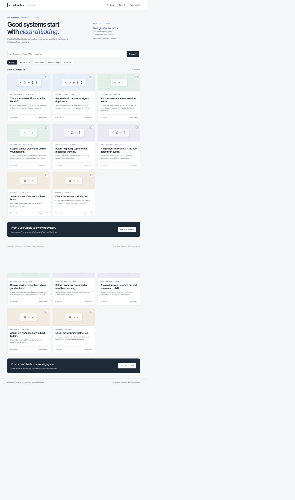
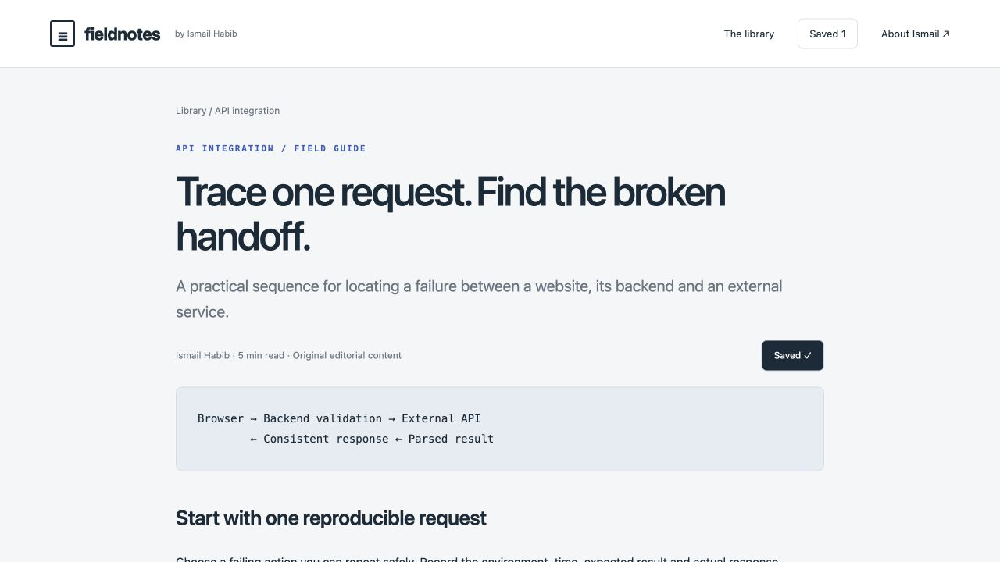

# Fieldnotes — Searchable Engineering Knowledge Library

A searchable engineering knowledge library with a custom WordPress theme and editable content plugin. Readers can search full article text, filter by topic and keep a browser-local reading list. A separate Python implementation is also included.

An independent project by Ismail Habib. Screenshots show the running application; any records shown are labelled verification data.

## Screenshots



The running WordPress knowledge library with search, filters and article cards.



Full article page with original content, practical checklist and bookmark control.

## Features

- Eight original articles with dedicated pages, checklists and workflow examples.
- Full-text search and topic filters with useful empty-result guidance.
- Browser bookmarks and a saved-resource view.
- WordPress custom post type, native editing and metadata fields; reactivation preserves edits.

## Quick start: WordPress

Run these commands from the repository directory.

Requirements: Docker Desktop running, Python 3, and internet access for the first image download.

```sh
python3 wordpress_setup.py
```

Open http://127.0.0.1:8188. This starts an isolated WordPress installation and MariaDB database, installs the included original theme and plugin, and prepares the content. Both Docker images are pinned by digest. WordPress 7.1.2 was actually executed during verification.

Admin: http://127.0.0.1:8188/wp-admin/ . Username: `port_admin`. The generated password is the `WP_ADMIN_PASSWORD` value in `.local.env`. Keep that file local; do not publish it. The file is generated on first run and is excluded from the deliverable. A fresh setup chooses a unique Docker project name, so it does not collide with the temporary verification environment. Keep the generated file to preserve access to that installation on subsequent runs. An example.invalid email is used for this local installation and setup mail is disabled. The database is stored in a dedicated Docker volume. No other project database is modified.

Stop without deleting data:

```sh
docker compose --env-file .local.env stop
```

Restart from this folder:

```sh
docker compose --env-file .local.env up -d
```

## Install on an existing WordPress site

1. Back up the site and test on staging.
2. Upload `fieldnotes-library.zip` through Appearance → Themes → Add New → Upload Theme, then activate it.
3. Upload `fieldnotes-content.zip` through Plugins → Add New → Upload Plugin, then activate it.
4. Save Settings → Permalinks to refresh rewrite rules.

Theme and plugin sources are in `wordpress/`. The included Docker bootstrap is only for the independent local installation; do not copy it into a live site’s public directory.

## Lightweight standalone runtime

```sh
python3 app.py
```

Open http://127.0.0.1:8108. This alternate implementation requires only Python’s standard library. It is a functioning application with the same original design and content; it is not an embedded WordPress installation. The WordPress and Python runtimes have separate storage. `PORT` can override the standalone port.

## Verification

```sh
python3 test_app.py
python3 test_wordpress.py
```

The first command launches its own temporary standalone test server. The second checks the running WordPress installation at its documented default port. See `TEST_RESULTS.md` for the exact checks and limitations.

## Scope and ownership

Original code, editorial content, layouts and CSS illustration assets are included. System fonts are used; there are no external image/font dependencies and no videos. The screenshots above were captured from the running WordPress application.

## Before public deployment

The included setup binds only to localhost. Use HTTPS, a proper host, strong administrator access and a site-specific privacy/retention policy before exposing a service publicly. The independent WordPress package can be installed on hosting after staging checks; this deliverable does not claim a public launch or client adoption.

## Library behavior

Eight original editorial resources cover API integration, AI automation, legacy software and WordPress. Search examines title and article content; topic filters combine with search. Each resource has its own full article page, checklist and clearly illustrative workflow. Empty searches show a recovery path. Bookmark buttons save slugs in browser localStorage; `/saved` in the standalone runtime and `/?saved=1` in WordPress show the saved list. Bookmarks stay on the current browser/origin and are not synchronized.

WordPress content is stored in the `fieldnote` custom post type. The plugin imports the original articles only when missing, exposes editing through the native content editor, and adds a metadata panel for topic, format and reading time. Re-activation does not overwrite edited articles. The standalone content source is `content/articles.json`; restart after changing it. The read-only standalone `/api/resources` endpoint supports `q` and `topic` parameters.

Reading times are editorial estimates, not measured user behavior. The library contains original explanatory material, not customer data. CSS patterns are illustrative graphics, not screenshots of external systems.

## License

[MIT License](LICENSE) — Copyright (c) 2026 Ismail Habib.

The license covers the original code and content in this repository. WordPress, MariaDB and other separately installed dependencies retain their own licenses.
